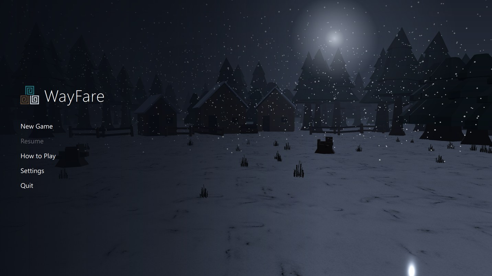
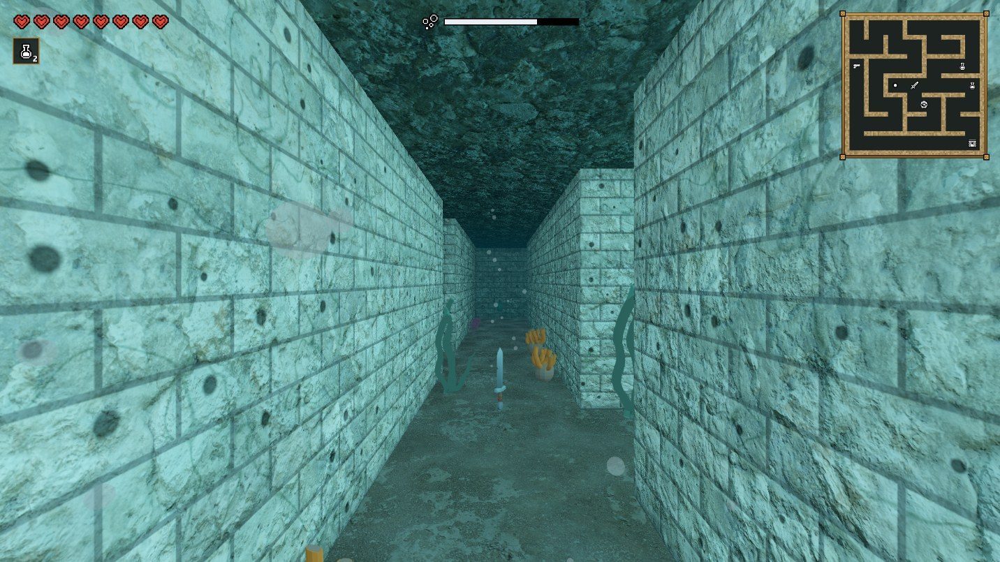
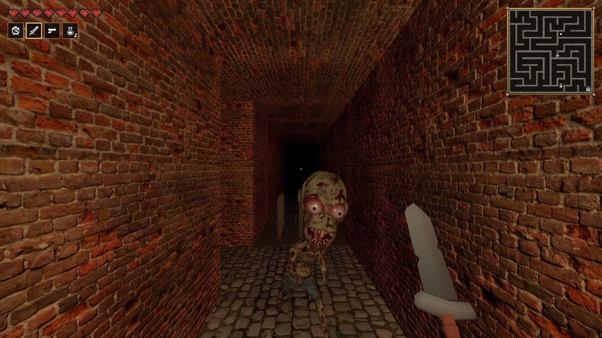
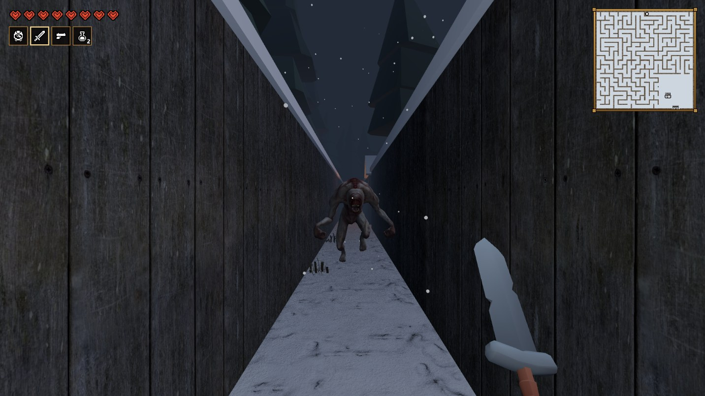
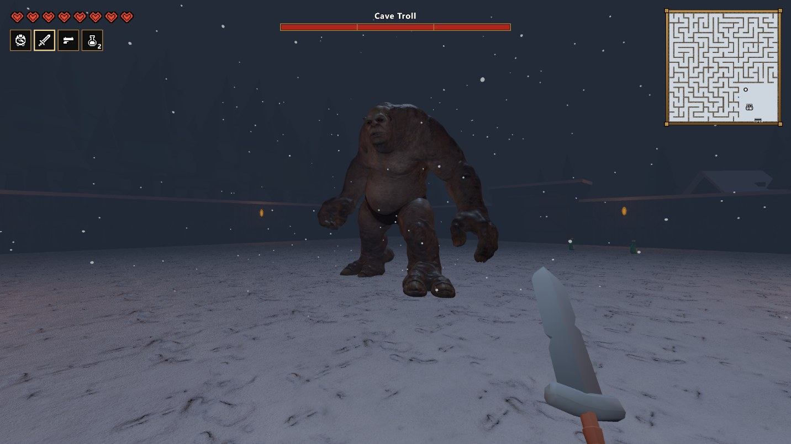

<div align="center">

# WayFare

</div>

<div align="center">
  
</div>


<div align="center">


</div>

<div align="center">
  
  
  
  
  
  
  
</div>

## Table of Contents

- [Overview](#overview)
  - [Story](#story)
  - [Objectives](#objectives)
  - [Levels](#levels)
  - [Screenshots](#screenshots)
  - [Controls](#controls)
  - [Architecture](#architecture)
  - [Algorithms](#algorithms)
- [Getting Started](#getting-started)
  - [Prerequisites](#prerequisites)
  - [Installation](#installation)
  - [Building](#building)
  - [Testing](#testing)
- [Documentation](#documentation)
- [Contributors](#contributors)

## Overview

**WayFare is a first-person 3D story game written in C++20 with Qt Quick 3D. The player crosses three maze levels, the Underwater Temple, the Dungeon and the Snowy Village, and then defeats a boss, the Cave Troll, to finish the game.**

### Story

One winter night something comes up through the ice of the village lake and takes the children. Mila, the hero's daughter, is the last. Her footprints end at a hole in the ice, and he dives in after her with nothing.

Under the lake lies a drowned temple. The diving gear, the sword and the pistol he finds there belong to parents who came this way before him, but he never finds the parents. He surfaces in a dungeon pool, climbs up into an abandoned barn and walks out into a snowed-in village full of stone statues, and past the village he faces the Cave Troll. Behind its gate the statues stand in pairs: every parent kneeling beside a small stone child. He finds Mila there, kneels and takes her hand, and the stone spreads into him. He does not let go.

The story is told only through the cutscenes and the hero's spoken lines, with captions; there is no narrator.

### Objectives

- Build a complete maze game that meets the assignment: start top-left, exit bottom-right, walls that block the player, a new maze on every run
- Keep a clean layered architecture where the game rules are plain C++ without Qt
- Cover those rules with unit tests
- Give the maze an original presentation with a story, three themed worlds, enemies and a boss fight

### Levels

In every level the player starts in the top-left room of the maze and must reach the exit in the bottom-right part.

| Level             | Size  | Enemies                         | Hazards          | Items                               | Exit condition                       |
| ----------------- | ----- | ------------------------------- | ---------------- | ----------------------------------- | ------------------------------------ |
| Underwater Temple | 15x15 | None                            | Drowning         | Diving gear, sword, pistol, potions | Sword and pistol collected, then swim up the flooded shaft |
| Dungeon           | 25x25 | 14 zombies                      | 12 spike traps   | Potions                             | Reach the exit ladder                |
| Snowy Village     | 45x45 | 16 nightmare creatures, Cave Troll | None          | Potions                             | Defeat the Cave Troll                |

- The player has **8 hearts** and is invincible for 1 second after a hit. At zero hearts the current level restarts.
- In the temple the air meter drains for 45 seconds, then the player loses one heart every 3 seconds. The diving gear stops the drowning; the hero leaves it behind when he reaches the dungeon.
- The **sword** hits enemies in front at close range; the **pistol** fires a ray with infinite ammo. There is no fighting in the temple.
- A **healing potion** restores 4 hearts; 2 to 3 potions spawn on every map.
- The **Cave Troll** has 75 health and 3 phases. Each phase starts with a roar during which it cannot be hurt, and its attacks have a windup, so they can be dodged.
- Four cutscenes tell the story: the frozen lake and the dive into the temple, the swim up into the dungeon (the hero takes off the diving gear), the climb into the barn, and the ending. Each has several camera shots, the hero's voice lines with captions, and can be skipped.
- The game saves on New Game, at the start of every level, and when leaving through the pause menu. Resume rebuilds the same maze from the saved seed; enemies respawn.

### Screenshots

<div align="center">
  
  <p>Main menu</p>
</div>

| | |
| :---: | :---: |
|  |  |
| Underwater Temple | Dungeon |
|  |  |
| Snowy Village | Cave Troll |

### Controls

| Key               | Action                          |
| ----------------- | ------------------------------- |
| W, A, S, D        | Move forward, left, back, right |
| Mouse             | Look around                     |
| Left mouse button | Attack with the selected weapon |
| 1 / 2             | Select sword / pistol           |
| 3                 | Select the healing potion       |
| Q                 | Drink the healing potion        |
| M                 | Enlarge the minimap             |
| Esc               | Pause menu                      |
| Space or Esc      | Skip a cutscene                 |

### Architecture

WayFare is split into four Visual Studio projects, one per layer, plus a test project. Each layer may call only the layer directly below it: Presentation calls Business, and Business calls DataAccess. Only the Presentation layer uses Qt for its logic, so the game rules can be compiled and tested without a window or a QML engine.

| Layer            | Directory               | Contents                                                                                                                                                   |
| ---------------- | ----------------------- | ---------------------------------------------------------------------------------------------------------------------------------------------------------- |
| **Application**  | `WayFare.Application/`  | `main.cpp` and the `Main.qml` window; creates the database, repositories and game service and passes them down by reference (dependency injection)          |
| **Presentation** | `WayFare.Presentation/` | QML views, model wrappers, ViewModels (`Game`, `Level`, `MainMenu`, `Settings`, `Assets`) and all render assets (3D models, textures, icons, audio)         |
| **Business**     | `WayFare.Business/`     | Game rules as plain C++ free functions: maze generation, movement, health, combat, enemies, spike traps, drowning, inventory, boss fight, `GameService`    |
| **DataAccess**   | `WayFare.DataAccess/`   | SQLite save game and settings: `Database`, `SaveRepository`, `SettingsRepository`; Qt Sql stays inside the `.cpp` files                                   |
| **Tests**        | `WayFare.Tests/`        | Microsoft CppUnitTest tests for Business and DataAccess                                                                                                     |

There are no singletons and no interfaces. Each layer keeps its data types in its own `models/` folder as plain structs and enums, and results follow the response-struct pattern (`struct XResponse { bool success; std::string errorMessage; ... }`) and status enums.

### Algorithms

| Algorithm                       | Category            | Time  | Space | Called              |
| ------------------------------- | ------------------- | ----- | ----- | ------------------- |
| Maze generation (iterative DFS) | Graph traversal     | O(n²) | O(n²) | Once per level load |
| Enemy pathfinding (BFS)         | Graph search        | O(n²) | O(n²) | Once per frame      |
| Player movement and collision   | Collision detection | O(1)  | O(1)  | Once per frame      |
| Boss state machine              | Finite state machine| O(1)  | O(1)  | Once per frame      |

n is the side length of the maze in tiles (15, 25 or 45). Random numbers come from a seeded `std::mt19937`, so the same seed always rebuilds the same maze.

## Getting Started

### Prerequisites

- **Windows 10 or 11**, 64-bit
- **Visual Studio 2026** with the "Desktop development with C++" workload
- **Qt 6.12 for MSVC 2022 64-bit** with the Qt Quick 3D, Qt Multimedia and Qt Sql modules - install via the [Qt Online Installer](https://www.qt.io/development/download-qt-installer-oss)
- **Qt Visual Studio Tools** extension, with Qt 6.12 `msvc2022_64` added as a Qt version
- **Git**

### Installation

Clone the repository:

```bash
git clone https://github.com/DIDimov24/WayFare.git
cd WayFare
```

The SQLite database `WayFare.DataAccess/data/WayFare.db` is created on the first run if it is missing - no separate setup needed.

### Building

1. Open `WayFare.slnx` in Visual Studio
2. Select **Debug | x64** and set `WayFare.Application` as the startup project
3. **Build > Build Solution**
4. **Debug > Start** (F5)

Qt VS Tools runs moc and the QML tools as part of the build, and a post-build step copies the `assets/` folder next to the executable. If the first build after changing Qt modules fails to link, build again.

The Mixamo hero animations are not in the repository (the Mixamo licence does not allow sharing them). The game still runs without them; only the cutscenes show no hero and no adult statues.

### Testing

Open Test Explorer in Visual Studio and click **Run All**, or run from a Developer Command Prompt:

```bash
vstest.console.exe bin\x64\Debug\WayFare.Tests.dll
```

There is one test file per area (maze generator, collision, health, inventory, drowning, combat, enemy AI, spike traps, boss, save/load), 12 test cases in total, matching the QA sheet.

## Documentation

- **Project Documentation** - [WayFare-Documentation.docx](https://codingburgas-my.sharepoint.com/:w:/g/personal/vybolotov24_codingburgas_bg/IQBDIgQ3BhEjQ7wddqrtbZDxAbgvhXK3Xng8uSmnVYiRRq4)
- **QA Test Cases** - [WayFare-QA.xlsx](https://codingburgas-my.sharepoint.com/:x:/g/personal/vybolotov24_codingburgas_bg/IQCJW0-H2RQiRr5cgHnmPARLAdGK1-xRLaN0MvjBBqK4p-Q)
- **Project Presentation** - [WayFare-Presentation.pptx](https://canva.link/xr9947vdleoch1w)
- **Asset Credits** - [CREDITS.md](./CREDITS.md)

## Contributors

- [**Denislav Dimov**](https://github.com/didimov24) - Scrum Master
- [**Vsevolod Bolotov**](https://github.com/vybolotov24) - Back-end Developer
- [**Georgi Georgiev**](https://github.com/gageorgiev24) - Back-end Developer
- [**Dimitar Rusev**](https://github.com/ddrusev24) - QA Engineer / Front-end Developer
